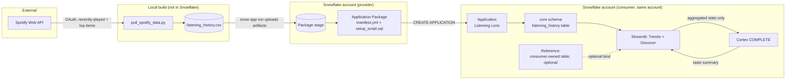

# Listening Lens: Solution Design Document

**Status:** Draft
**Date:** 2026-09-11
**Author:** Jay

## 1. Overview

Listening Lens is a Snowflake Native App: a Streamlit dashboard, backed by SQL/Snowpark and Snowflake Cortex, packaged so it installs and runs entirely inside a consumer's own account. This document describes how the pieces fit together. For *why* these choices were made over the alternatives, see [`docs/adr/0001-architecture.md`](adr/0001-architecture.md). For *what* is in and out of scope, see [`docs/requirements.md`](requirements.md).

## 2. Goals

Same goals as the requirements document, restated briefly for context: a working, installable Native App that demonstrates the application package lifecycle and the references/bind mechanism, documented and demoed to a public-portfolio standard, buildable in days by one person on a disposable trial account.

## 3. System Context

Two roles, one person:

- **Provider** builds the application package: manifest, setup script, Streamlit code, sample data pipeline.
- **Consumer** installs and runs the app. In this build, provider and consumer are the same Snowflake account, which the current Native Apps Framework explicitly supports for local testing without a Marketplace listing.

External systems: the Spotify Web API (data source) and Snowflake Cortex (the Discover tab's summary generation). Neither is a hard dependency of the framework itself; both are specific to what this particular app does.

## 4. Component Breakdown

| Component | Responsibility | Technology |
|---|---|---|
| `pull_spotify_data.py` | One-time pull of recently-played tracks and top artists/tracks from the Spotify Web API; flattens to CSV | Python, Spotify Web API |
| `snowflake.yml` | `snow` CLI project definition: what the application package contains, where it deploys | Snowflake CLI project config |
| `manifest.yml` | Declares the app's artifacts, requested privileges (each with a description), and the optional reference | Native App manifest, `manifest_version: 2` |
| `setup_script.sql` | Runs at install: creates the application role, `core` schema, reference definition, loads bundled sample data, grants usage | SQL, executed by the framework at install/upgrade |
| `streamlit/listening_lens.py` | Trends tab (SQL aggregation) and Discover tab (Cortex call) | Streamlit-in-Snowflake, Snowpark |
| Cortex `COMPLETE` | Generates the natural-language taste summary from aggregated stats | Snowflake Cortex AI function |
| `scripts/bootstrap_account.sql` | One-time role/warehouse/privilege setup on any fresh account, making the account itself disposable | SQL |
| `scripts/parse_extended_history.py` | Alternative to `pull_spotify_data.py`: parses Spotify's Extended Streaming History export (once it arrives) into the same CSV schema and path, added 2026-09-13 | Python, standard library only |
| `core.register_single_reference` (in `setup_script.sql`) | FR-6 callback procedure the framework invokes to bind/unbind a consumer table against `listening_history_ref`, added 2026-09-13 | SQL, `SYSTEM$SET_REFERENCE`/`SYSTEM$REMOVE_REFERENCE`/`SYSTEM$REMOVE_ALL_REFERENCES` |
| `scripts/test_fr6_reference_bind.sql` | One-time local test fixture: a small, obviously-distinct table plus the bind/unbind/cleanup statements used to confirm FR-6 end to end, added 2026-09-13 | SQL, not part of the app itself |

## 5. Data Flow

1. `pull_spotify_data.py` authenticates against the Spotify Web API (Development Mode, own account) and pulls recently-played tracks plus short/medium/long-term top artists and tracks. Alternatively, once Spotify's Extended Streaming History export has arrived, `scripts/parse_extended_history.py` parses it directly, no API call or auth needed, and writes the same output.
2. Either script flattens its source into `data/listening_history.csv` (not committed to git; regenerated on demand, including after a redeploy to a new account). Running one overwrites the other's output rather than merging with it.
3. `snow app run` uploads the project's artifacts (manifest, setup script, Streamlit code, and a reference to the CSV via a stage) and creates or upgrades the application package.
4. The setup script runs at install: creates the application role and `core` schema, loads the staged sample data into a table, defines the optional reference, and grants the application role usage on everything the Streamlit page needs.
5. Opening the Streamlit page's Trends tab loads the whole table via Snowpark into a pandas DataFrame, then computes top artists, an hour-of-day distribution, and the longest streak client-side over whichever rows carry a real `played_at` (`recently_played` and `extended_history`; `top_tracks_*`/`top_artists_*` ranking rows are not used for these, see the 2026-09-13 note below). A genre breakdown runs only if `genre_tags` actually has data; against Jay's own pulled dataset it currently does not (see the data model note below), so the tab's real feature set is the three that don't depend on it.

   **Revised 2026-10-07:** hour of day, the longest streak and the drill-through's timestamps now use the listener's local time (`DISPLAY_TIMEZONE`, Australia/Brisbane, with a fixed UTC+10 fallback), since `played_at` is UTC and grouping on it raw shifted the whole day by ten hours. Date-window cutoffs stay in UTC because they compare instants. Top artists is drawn as an Altair chart sorted by play count; `st.bar_chart` had been re-sorting the bars alphabetically.

   **Revised 2026-09-13:** originally this filtered to `source = 'recently_played'` and `source = 'top_artists_{window}'`, which was correct when those were the only sources with real play events or rankings. Loading the Extended Streaming History (FR-7) added a much larger `extended_history` source, but nothing here was updated to read it, so the new data sat in the table completely unused, a bug caught by a longest-streak number that didn't move after loading years of new data. Fixed by filtering to any source with a real `played_at` timestamp, and by replacing the old ranking-window selector with a real date-based one now that real timestamps exist at scale. See `docs/build-log.md`.
6. Opening the Discover tab aggregates the same data further (top-line stats only), passes that aggregate, not raw rows, to Cortex `COMPLETE`, and displays the returned summary.
7. Optionally, a consumer grants the defined reference to their own listening-history table (matching the expected schema); the app then reads from that table instead of the bundled one. This path is demonstrated separately, not as part of the main recorded demo (see the ADR's risk reasoning).

   **Added and confirmed live 2026-09-13:** `load_history()` calls `SYSTEM$GET_ALL_REFERENCES('listening_history_ref', True)` to check whether a consumer has bound a table, and if so, reads it via `SELECT * FROM reference('listening_history_ref', alias)`, Snowflake's dedicated table function for querying through a reference. Querying by the bound table's literal fully-qualified name instead (`IDENTIFIER('db.schema.table')`) was tried first and fails: the application object has no general USAGE on the consumer's database or schema, only the specific privilege the reference itself captured, so `reference()` exists precisely to read through that narrower grant. See `docs/build-log.md`, 2026-09-13 entry, for the full diagnosis, including a separate `GRANT MONITOR` vs. `GRANT USAGE` grant mistake hit along the way. The Trends tab's Top artists panel also gained a drill-through the same day: selecting an artist shows the real underlying play rows for the current window, live-queried from whichever table is actually loaded.

   **Revised 2026-10-07:** the binding check now runs on every page run and its result (the alias, or none) is passed into the cached `load_history(alias)` as its argument. Previously the lookup sat inside the cached function, so after a bind or unbind the app kept serving the previous data source until the cache expired. The drill-through table also uses a fixed height, after a very small bound result intermittently triggered a resize loop in Streamlit's table component.

## 6. Data Model

Single core table, `core.listening_history`, shape shared by both the bundled dataset and anything bound via the reference. Revised from the original design once `pull_spotify_data.py` was actually built against the live API: two columns turned out to need to be nullable, because top-tracks/top-artists rows are rankings, not play events.

| Column | Type | Notes |
|---|---|---|
| `played_at` | TIMESTAMP_NTZ, nullable | Real play timestamp for `recently_played` rows; null for ranking rows, which have no play event |
| `track_name` | STRING, nullable | Null for `top_artists_*` rows, which rank artists, not specific tracks |
| `artist_name` | STRING | |
| `genre_tags` | ARRAY, in practice empty | Spotify's February 2026 platform changes removed the batch artist-lookup endpoint from Development Mode, confirmed by a live 403 during build, so `recently_played` and `top_tracks_*` rows carry no genre tag at all, by design. `top_artists_*` rows were meant to be the one surviving source, sourced inline from a still-supported endpoint, but a live pull returned genre tags for 0 of 130 such rows against Jay's own account. Kept in the schema for forward compatibility if Spotify fixes this; not something the Trends tab depends on. See requirements OQ-3. |
| `source` | STRING | `recently_played`, `top_tracks_{short\|medium\|long}_term`, `top_artists_{short\|medium\|long}_term`, or `extended_history` (added 2026-09-13) |
| `rank` | INTEGER, nullable | Position (1-50) within a top-tracks/top-artists window; null for `recently_played` and `extended_history` rows, since both are real play events, not rankings |

**Added 2026-09-13: `extended_history` rows.** Spotify's Extended Streaming History export (requested 2026-09-11, arrived 2026-09-13) is parsed by `scripts/parse_extended_history.py` into the same schema as the API-sourced rows above, so no table or column changes were needed. Two decisions came out of actually inspecting the real export, not from the design doc:

- The export includes a separate `Streaming_History_Video_*.json` set (video content) alongside the audio history. Not read at all: out of scope for a music listening app, and a different content type than what the Trends and Discover tabs analyze.
- Of 131,935 raw audio rows, 103 had no track/artist metadata (podcast plays that Spotify's export mixes into the audio history file) and were dropped. Of the remaining rows, 89,466 (67.9%) had `ms_played` under 30 seconds, essentially skips or previews rather than listens. There's no official Spotify-published threshold for what counts as a play; 30 seconds is the commonly cited industry figure and matches the intuitive line between "skipped past it" and "played it," so rows under it are dropped entirely rather than kept with a flag, to avoid changing the existing Trends tab queries. 42,366 rows survive both filters, spanning 2018-06-04 to 2026-09-11, a large jump from the roughly 330-row API-sourced sample.
- **Added 2026-10-07:** `parse_extended_history.py --exclude-artist` drops plays by named artists at ingestion. The bundled dataset excludes a children's bedtime album played nightly on the same account (two artist credits, 1,492 plays), which had been ranking second all time and skewing the Discover prompt. 40,874 counted plays remain.
- `genre_tags` stays empty for `extended_history` rows too; the export has no genre field, consistent with the existing gap (OQ-3), not a new one.

No personally identifying information beyond track and artist names, which is what the whole app is about displaying. No employer data of any kind touches this schema. The Extended Streaming History export additionally includes `conn_country` and `ip_addr` per row (Spotify logs the network location of each play); neither is read by the parser or written to the CSV, keeping the same privacy boundary as the API-sourced data.

## 7. Security and Privacy Considerations

- **Least privilege:** every privilege in `manifest.yml`'s `privileges` block carries a description and maps to a specific feature (traceable to a requirement in `docs/requirements.md`, NFR-5).
- **Aggregation boundary before Cortex:** the Discover tab sends aggregated statistics to Cortex `COMPLETE`, not raw per-track listening rows. This is a design rule (FR-4), verified by reading the actual query at build time, not assumed from intent.
- **Personal data, publicly shown, by informed choice:** the bundled dataset is Jay's own real listening history, shown on screen in a public repo's demo recording. This was a deliberate call, not an oversight, since it's music taste rather than sensitive data, and a synthetic dataset was considered and declined.
- **No employer boundary crossing:** everything runs on a personal trial account. No employer Snowflake account, credentials, or data is ever in scope (NFR-1).

## 8. Assumptions

- A personal Spotify Developer app in Development Mode can call `recently-played` and top-items endpoints against the developer's own account immediately, without Spotify's app review process. Confirmed working 2026-09-12. The batch artist-lookup endpoint is not part of this assumption; it's confirmed unavailable (see the data model note on `genre_tags`).
- The app owner's Spotify account has an active Premium subscription, which Spotify's February 2026 changes require for any Development Mode app. Not verifiable from documentation alone; the build working at all is the practical confirmation.
- The trial account is created in a region with direct Cortex model support (avoiding a cross-region inference configuration step); if a future redeploy lands in an unsupported region, cross-region inference is the documented fallback.
- Cortex `COMPLETE` is callable at all from a trial account. Initially proven false 2026-09-12: Snowflake's trial-account policy blocks Cortex AI function calls outright without a payment method on file, an account-tier restriction, not a credit-quota one (see OQ-1 in the requirements doc). The manifest's `snowflake_database` declaration and an explicit `GRANT DATABASE ROLE ... TO APPLICATION` were both necessary but not sufficient, this restriction sat above both. Resolved the same day: added a payment method, confirmed live afterward that `COMPLETE` succeeds and `llama3.1-8b` is available in this account's region.

## 9. Risks

| Risk | Impact | Mitigation |
|---|---|---|
| Spotify data-export queue (up to 30 days) blocks getting real history | Delays a "nice to have" upgrade, not the core build | API-sourced bundled dataset is the primary path; export is requested in parallel, not depended on |
| Reference/bind path fails live during a recording | Wastes a take, undermines the more advanced feature's demo | Recorded separately from the main take, per ADR Option C. Built and confirmed live 2026-09-13, bind and unbind both verified against a throwaway test table before recording; see `docs/build-log.md` |
| Cortex `COMPLETE` is blocked for trial accounts without a payment method (realized 2026-09-12, OQ-1: confirmed an account-tier restriction, not a credit-quota one) | Discover tab could not be demoed live until resolved | Resolved 2026-09-12: added a payment method to the trial account. Confirmed live afterward that `COMPLETE` succeeds. Still worth keeping a pre-recorded fallback clip of the Discover tab as a backup for the actual recording, live AI calls can be flaky on a single take regardless of account tier |
| Genre data is realized as fully unavailable, not just sparse (confirmed 2026-09-12, OQ-3: 0 of 130 top-artists rows had a genre tag) | Would weaken the "real insight" moment in the demo script if genre had stayed a planned feature | Resolved by scope change, not workaround: FR-3 dropped the genre view as a requirement, Trends tab built around top artists, the heatmap, and streaks instead |

## 10. Traceability

This document maps to `docs/requirements.md` as follows: sections 3 to 6 describe how FR-1 through FR-5 (and the FR-6 reference path) are implemented; section 7 addresses NFR-1 and NFR-5; section 8's assumptions and section 9's risks correspond directly to the open questions (OQ-1 to OQ-3) in the requirements document.

## 11. Out of Scope

Same non-goals as the requirements document: no multi-tenant or concurrent-consumer support, no cost optimization or production monitoring, no security-review-grade hardening, no Extended Streaming History ingestion in v1. See `docs/requirements.md` for the full list and rationale.
