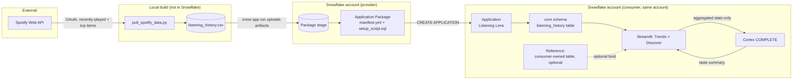

# Listening Lens: Solution Design Document

**Status:** Draft
**Date:** 2026-09-11
**Author:** Jay

## 1. Overview

Listening Lens is a Snowflake Native App: a Streamlit dashboard, backed by SQL/Snowpark and Snowflake Cortex, packaged so it installs and runs entirely inside a consumer's own account. This document describes how the pieces fit together. For *why* these choices were made over the alternatives, see [`docs/adr/0001-architecture.md`](adr/0001-architecture.md). For *what* is in and out of scope, see [`docs/requirements.md`](requirements.md).

## 2. Goals

Same goals as the requirements document, restated briefly for context: a working, installable Native App that demonstrates the application package lifecycle and the references/bind mechanism, documented and demoed to a public-portfolio standard, buildable in days by one person on a disposable trial account.

## 3. System Context

Two roles, one person:

- **Provider** builds the application package: manifest, setup script, Streamlit code, sample data pipeline.
- **Consumer** installs and runs the app. In this build, provider and consumer are the same Snowflake account, which the current Native Apps Framework explicitly supports for local testing without a Marketplace listing.

External systems: the Spotify Web API (data source) and Snowflake Cortex (the Discover tab's summary generation). Neither is a hard dependency of the framework itself; both are specific to what this particular app does.

## 4. Component Breakdown

| Component | Responsibility | Technology |
|---|---|---|
| `pull_spotify_data.py` | One-time pull of recently-played tracks and top artists/tracks from the Spotify Web API; flattens to CSV | Python, Spotify Web API |
| `snowflake.yml` | `snow` CLI project definition: what the application package contains, where it deploys | Snowflake CLI project config |
| `manifest.yml` | Declares the app's artifacts, requested privileges (each with a description), and the optional reference | Native App manifest, `manifest_version: 2` |
| `setup_script.sql` | Runs at install: creates the application role, `core` schema, reference definition, loads bundled sample data, grants usage | SQL, executed by the framework at install/upgrade |
| `streamlit/listening_lens.py` | Trends tab (SQL aggregation) and Discover tab (Cortex call) | Streamlit-in-Snowflake, Snowpark |
| Cortex `COMPLETE` | Generates the natural-language taste summary from aggregated stats | Snowflake Cortex AI function |
| `scripts/bootstrap_account.sql` | One-time role/warehouse/privilege setup on any fresh account, making the account itself disposable | SQL |

## 5. Data Flow

1. `pull_spotify_data.py` authenticates against the Spotify Web API (Development Mode, own account) and pulls recently-played tracks plus short/medium/long-term top artists and tracks.
2. The script flattens this into `data/listening_history.csv` (not committed to git; regenerated on demand, including after a redeploy to a new account).
3. `snow app run` uploads the project's artifacts (manifest, setup script, Streamlit code, and a reference to the CSV via a stage) and creates or upgrades the application package.
4. The setup script runs at install: creates the application role and `core` schema, loads the staged sample data into a table, defines the optional reference, and grants the application role usage on everything the Streamlit page needs.
5. Opening the Streamlit page's Trends tab runs SQL aggregations directly against the loaded table: top artists, an hour-of-day heatmap, and listening streaks. A genre breakdown runs only if `genre_tags` actually has data; against Jay's own pulled dataset it currently does not (see the data model note below), so the tab's real feature set is the three that don't depend on it.
6. Opening the Discover tab aggregates the same data further (top-line stats only), passes that aggregate, not raw rows, to Cortex `COMPLETE`, and displays the returned summary.
7. Optionally, a consumer grants the defined reference to their own listening-history table (matching the expected schema); the app then reads from that table instead of the bundled one. This path is demonstrated separately, not as part of the main recorded demo (see the ADR's risk reasoning).

## 6. Data Model

Single core table, `core.listening_history`, shape shared by both the bundled dataset and anything bound via the reference. Revised from the original design once `pull_spotify_data.py` was actually built against the live API: two columns turned out to need to be nullable, because top-tracks/top-artists rows are rankings, not play events.

| Column | Type | Notes |
|---|---|---|
| `played_at` | TIMESTAMP_NTZ, nullable | Real play timestamp for `recently_played` rows; null for ranking rows, which have no play event |
| `track_name` | STRING, nullable | Null for `top_artists_*` rows, which rank artists, not specific tracks |
| `artist_name` | STRING | |
| `genre_tags` | ARRAY, in practice empty | Spotify's February 2026 platform changes removed the batch artist-lookup endpoint from Development Mode, confirmed by a live 403 during build, so `recently_played` and `top_tracks_*` rows carry no genre tag at all, by design. `top_artists_*` rows were meant to be the one surviving source, sourced inline from a still-supported endpoint, but a live pull returned genre tags for 0 of 130 such rows against Jay's own account. Kept in the schema for forward compatibility if Spotify fixes this; not something the Trends tab depends on. See requirements OQ-3. |
| `source` | STRING | `recently_played`, `top_tracks_{short\|medium\|long}_term`, or `top_artists_{short\|medium\|long}_term` |
| `rank` | INTEGER, nullable | Position (1-50) within a top-tracks/top-artists window; null for `recently_played` rows |

No personally identifying information beyond track and artist names, which is what the whole app is about displaying. No employer data of any kind touches this schema.

## 7. Security and Privacy Considerations

- **Least privilege:** every privilege in `manifest.yml`'s `privileges` block carries a description and maps to a specific feature (traceable to a requirement in `docs/requirements.md`, NFR-5).
- **Aggregation boundary before Cortex:** the Discover tab sends aggregated statistics to Cortex `COMPLETE`, not raw per-track listening rows. This is a design rule (FR-4), verified by reading the actual query at build time, not assumed from intent.
- **Personal data, publicly shown, by informed choice:** the bundled dataset is Jay's own real listening history, shown on screen in a public repo's demo recording. This was a deliberate call, not an oversight, since it's music taste rather than sensitive data, and a synthetic dataset was considered and declined.
- **No employer boundary crossing:** everything runs on a personal trial account. No employer Snowflake account, credentials, or data is ever in scope (NFR-1).

## 8. Assumptions

- A personal Spotify Developer app in Development Mode can call `recently-played` and top-items endpoints against the developer's own account immediately, without Spotify's app review process. Confirmed working 2026-09-12. The batch artist-lookup endpoint is not part of this assumption; it's confirmed unavailable (see the data model note on `genre_tags`).
- The app owner's Spotify account has an active Premium subscription, which Spotify's February 2026 changes require for any Development Mode app. Not verifiable from documentation alone; the build working at all is the practical confirmation.
- The trial account is created in a region with direct Cortex model support (avoiding a cross-region inference configuration step); if a future redeploy lands in an unsupported region, cross-region inference is the documented fallback.
- Cortex `COMPLETE` trial credit is sufficient for development and demo-recording usage. Not confirmed from documentation; flagged as OQ-1 in the requirements doc, to be checked directly in the account.

## 9. Risks

| Risk | Impact | Mitigation |
|---|---|---|
| Spotify data-export queue (up to 30 days) blocks getting real history | Delays a "nice to have" upgrade, not the core build | API-sourced bundled dataset is the primary path; export is requested in parallel, not depended on |
| Reference/bind path fails live during a recording | Wastes a take, undermines the more advanced feature's demo | Recorded separately from the main take, per ADR Option C |
| Cortex credit or quota runs out mid-demo | Discover tab breaks on camera | Check credit early (OQ-1), keep a pre-recorded fallback clip of the Discover tab if needed |
| Genre data is realized as fully unavailable, not just sparse (confirmed 2026-09-12, OQ-3: 0 of 130 top-artists rows had a genre tag) | Would weaken the "real insight" moment in the demo script if genre had stayed a planned feature | Resolved by scope change, not workaround: FR-3 dropped the genre view as a requirement, Trends tab built around top artists, the heatmap, and streaks instead |

## 10. Traceability

This document maps to `docs/requirements.md` as follows: sections 3 to 6 describe how FR-1 through FR-5 (and the FR-6 reference path) are implemented; section 7 addresses NFR-1 and NFR-5; section 8's assumptions and section 9's risks correspond directly to the open questions (OQ-1 to OQ-3) in the requirements document.

## 11. Out of Scope

Same non-goals as the requirements document: no multi-tenant or concurrent-consumer support, no cost optimization or production monitoring, no security-review-grade hardening, no Extended Streaming History ingestion in v1. See `docs/requirements.md` for the full list and rationale.
